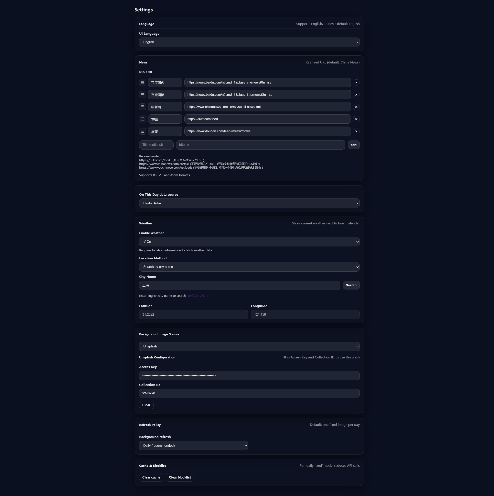

English | [中文](README.zh.md)

# Glance
A Chrome new tab extension with a calendar, dual time zones, weather, RSS news, On This Day, and wallpapers.




# Installation

1. Open Chrome: `chrome://extensions`
2. Enable "Developer mode" in the top-right corner
3. Click "Load unpacked" and select this directory (contains `manifest.json`)
4. Open a new tab to verify

# Features

## Calendar and Time Zones

- The Gregorian date uses your device's local time. Choose **Automatic**, **UK**, **US**, or **Numeric** in **Settings → Language → Date format**. The weekday follows the interface language.
- **Automatic** is the default. It uses Chrome's regional preference and shows a live preview with the browser locale and today's formatted date.
- The **Chinese lunar date and zodiac** are off by default. When enabled, they follow Beijing time, so the lunar date may correspond to a different day from the local Gregorian date around midnight.
- The **dual time zone** display is off by default. When enabled, it shows the date and time in your device's local time zone and in Beijing, London, New York, Tokyo, or UTC. Beijing is the default second time zone.

## Weather

- **Display**:
  - Current weather: icon + temperature + precipitation (if any)
  - Air quality: AQI value + level icon (Excellent/Good/Light/Moderate/Heavy/Severe)
  - Tomorrow forecast: icon + low~high temperature
- **Location options** (choose one):
  1. **Auto**: browser geolocation API (permission required)
  2. **Manual city input**: enter English city name (e.g. Shanghai, New York); it searches and gets coordinates. Manual input is recommended to avoid inaccurate location.
- **Data sources**:
  - Weather: Open-Meteo Forecast API
  - Air quality: Open-Meteo Air Quality API
- **Cache**: weather and air quality cached for 1 hour to reduce API requests

## News

- **Settings → News** shows both Chinese-language and English-language recommendations in either interface language. Subscribe in one click to 19 China News Service channels, four VOA News channels, IT Home, or The Guardian World. You can also add your own RSS 2.0 or Atom feed URL.
- On each new tab, the news card shows available cached articles first. Feeds with no cache or a cache that is at least **20 minutes** old refresh independently. Each request has an **8-second** timeout.
- If a refresh fails, saved articles remain visible for up to **24 hours after the last successful fetch**. After that, the card shows a load failure for that feed.
- The news card shows as many complete articles as fit. Use the left and right arrows to browse feed tabs when they exceed the available width.

## On This Day

- **Optional data sources**:
  - **Baidu Baike** (default, Chinese, 30-char limit)
  - **Wikipedia** (languages: zh / en / ja / fr ..., 60-char limit)
- Shows 3 events, sorted by year descending
- Click to open detail page

## Background Images

- **Five sources**:
  1. **Local images**: use images in `img/` (add your own, then run `generate_manifest.py` to generate the list)
  2. **Local uploads**: drag and drop to browser IndexedDB (supports import/export backups)
  3. **Bing random wallpaper** (default, no key required)
  4. **Bing today's wallpaper**
  5. **Unsplash** (optional, needs an Access Key and Collection ID). [Unsplash developer documentation](https://unsplash.com/developers)
- **Refresh**: fixed one per day / random each open
- **Image management**:
  - Image source shown in bottom-right
  - Right-click the credit to block the current image and auto-load another
  - Uploaded images can be exported as JSON and imported from backups

# Settings Page

- **Language** includes the interface language (English or Chinese), date format, lunar date, and dual time zone settings.
- **News** lets you subscribe, add or edit feed URLs, drag to reorder, remove feeds, and clear the news cache.
- **On This Day** lets you choose Baidu Baike or Wikipedia. The language code appears when Wikipedia is selected.
- **Weather**:
  - Enable/disable weather (default off)
  - Location:
    - **Auto**: click to request geolocation permission
    - **Manual city input**: enter English city name, click "Search", choose a city to fill coordinates
  - Verify cities: <https://open-meteo.com/en/docs/geocoding-api>
- **Background**:
  - Source (Local images / Local uploads / Bing random / Bing daily / Unsplash)
  - Unsplash Access Key / Collection ID (only for Unsplash)
  - Refresh strategy
  - Upload area (only for "Local uploads")
  - Import/export
- **Cache and blocklist** controls are available in the News, On This Day, and background sections.

# Local Images and Uploads

## Bulk import into local images (good for large collections)

1. Put images into `img/` (subfolders supported)
2. Generate the manifest:

   ```bash
   python generate_manifest.py
   ```

3. Select "Local images" as the background source in settings

## Upload images as background

1. Select "Local uploads" in settings
2. Drag images into the upload area or click to choose files
3. Images are saved to browser IndexedDB
4. (Optional) click "Export images" to back up, or "Import images" to restore

# Tips

- **Right-click image credit**: block the current image and auto-load another
- **Hover news/history cards**: remove blur for easier reading
- **Hover weather**: show detailed weather info (description, AQI level, tomorrow forecast)
- **Auto-save**: changes save automatically; "Saved" appears at the top
- **Image backup**: export uploaded images regularly to avoid loss after clearing browser data
