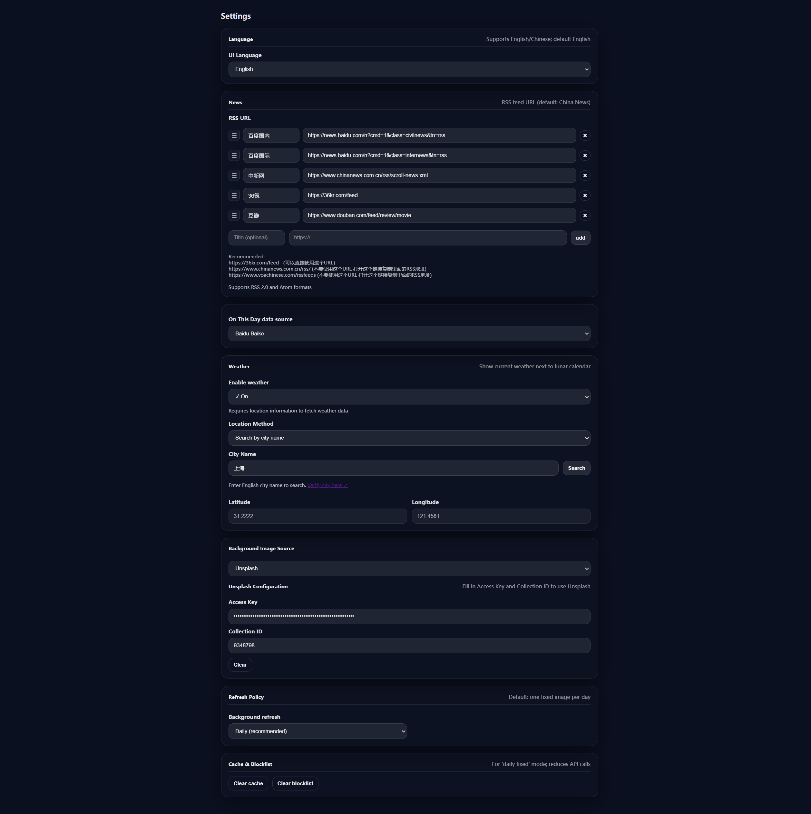

[English](README.md) | 中文

# 看尽
中文名：看尽
英文名: Glance
一个 Chrome 新标签页扩展，提供日历、双时区、天气、RSS 新闻、历史上的今天和壁纸。





# 📦 安装方法

1. 打开 Chrome：`chrome://extensions`
2. 右上开启"开发者模式"
3. 点击"加载已解压的扩展程序"，选择本目录（包含 `manifest.json`）
4. 打开一个新标签页验证

# ✨ 功能介绍

## 📅 日历与双时区

- 公历按设备本地时间显示。在「设置 → 语言 → 日期格式」可选**自动、英式、美式、数字日期**，星期随界面语言切换。
- **自动**为默认选项，按 Chrome 的地区偏好排版，并实时预览浏览器语言地区和当天日期。
- **农历和生肖**默认关闭。开启后按北京时间计算，北京和设备本地跨日时间不同时，两行日期可能对应不同的公历日。
- **双时区**默认关闭。开启后同时显示本地和第二时区的日期及时间。第二时区默认北京，也可选伦敦、纽约、东京或 UTC。

## 🌤️ 天气信息

- **显示内容**：
  - 当前天气：图标 + 温度 + 降水（如有）
  - 空气质量：AQI 值 + 等级图标（🟢优 / 🟡良 / 🟠轻度污染 / 🔴中度污染 / 🟣重度污染 / ⚫严重污染）
  - 明天预报：图标 + 最低~最高温度
- **位置获取方式**（二选一）：
  1. **自动获取**：使用浏览器地理位置 API（需要授权）
  2. **手动输入城市**：输入英文城市名（如：Shanghai, New York），自动搜索并获取经纬度。优先选择手填，防止定位不准
- **数据来源**：
  - 天气数据：Open-Meteo Forecast API
  - 空气质量：Open-Meteo Air Quality API
- **缓存策略**：天气和空气质量数据缓存 1 小时，减少 API 请求

## 📰 新闻

- 「设置 → 新闻」同时显示中文语言区和英文语言区。一键订阅涵盖中新网 19 个栏目、VOA News 4 个栏目，以及 IT之家和 The Guardian World。也可手动添加 RSS 2.0 或 Atom 订阅地址。
- 打开新标签页时，新闻卡片优先显示缓存。没有缓存或缓存已满 **20 分钟**的订阅源会独立刷新，单次请求超时为 **8 秒**。
- 刷新失败时，可继续显示上次成功获取的新闻，最长保留 **24 小时**。满 24 小时后，对应订阅源只显示加载失败提示。
- 新闻卡片按可用高度展示能完整放下的条目。订阅源一行放不下时，可用左右箭头翻看。

## 📜 历史上的今天

- **数据源可选**：
  - **百度百科**（默认，中文，30 字符限制）
  - **Wikipedia**（可选语言：zh / en / ja / fr ...，60 字符限制）
- 显示 3 条历史事件，按年份倒序排列
- 支持点击跳转到详情页面

## 🖼️ 背景图

- **五种来源可选**：
  1. **本地图片**：使用 `img/` 文件夹中的图片（可以自己添加图片后 需运行 `generate_manifest.py` 生成清单）
  2. **本地上传图片**：拖拽上传图片到浏览器 IndexedDB（支持导入/导出备份）
  3. **Bing 随机壁纸**（默认，免 Key）
  4. **Bing 今日壁纸**
  5. **Unsplash**（需填写 Access Key 和 Collection ID）。[Unsplash 开发文档](https://unsplash.com/developers)
- **刷新策略**：每天固定一张 / 每次打开随机
- **图片管理**：
  - 右下角显示图片来源
  - 右键图片署名可屏蔽当前图片并自动换一张
  - 上传的图片支持导出为 JSON 备份，支持从备份导入

# ⚙️ 设置页介绍

- **语言设置**可跟随 Chrome 语言，或手动选择英文、简体中文。其他 Chrome 界面语言回退为英文。这里也可以选择日期格式、开启农历和双时区。
- **新闻配置**可一键订阅、手动添加或编辑地址、拖动排序、移除订阅源和清空新闻缓存。
- **历史上的今天**可选择百度百科或 Wikipedia。选中 Wikipedia 时会显示语言代码。
- **天气配置**：
  - 启用/禁用天气（默认关闭）
  - 获取位置方式：
    - **自动获取**：点击按钮，浏览器会请求地理位置授权
    - **手动输入城市**：输入英文城市名，点击"搜索"，从结果中选择城市自动填充经纬度
  - 可验证城市：<https://open-meteo.com/en/docs/geocoding-api>
- **背景图配置**：
  - 背景图片来源（本地图片 / 本地上传图片 / Bing 随机壁纸 / Bing 今日壁纸 / Unsplash）
  - Unsplash Access Key / Collection ID（仅在选择 Unsplash 时显示）
  - 背景刷新策略
  - 上传图片区域（仅在选择"本地上传图片"时显示）
  - 图片导入/导出功能
- **缓存与屏蔽列表**可在新闻、历史上的今天和背景图对应的设置区中清理。

# 关于本地图片/上传图片

## 如果想批量导入图片到本地图片作为背景 (合适大量图片)

1. 将图片放入 `img/` 文件夹（支持子文件夹）
2. 运行脚本生成清单：

   ```bash
   python generate_manifest.py
   ```

3. 在设置页选择"本地图片"作为背景来源

## 上传图片作为背景

1. 在设置页选择"本地上传图片"
2. 拖拽图片到上传区域，或点击选择文件
3. 图片会自动保存到浏览器 IndexedDB
4. （可选）点击"导出图片"备份，或"导入图片"恢复

# 💡 小技巧

- **右下角图片署名（credit）右键**：屏蔽当前图片并自动换一张
- **鼠标悬停新闻/历史卡片**：去除模糊，方便阅读
- **天气信息悬停**：显示详细天气信息（天气描述、AQI 等级、明天预报）
- **自动保存**：所有设置修改后自动保存，顶部会显示"已保存"提示
- **图片备份**：定期导出上传的图片，避免浏览器数据清除后丢失
